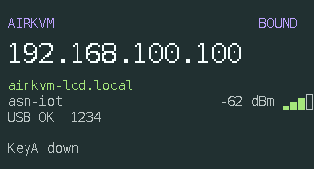
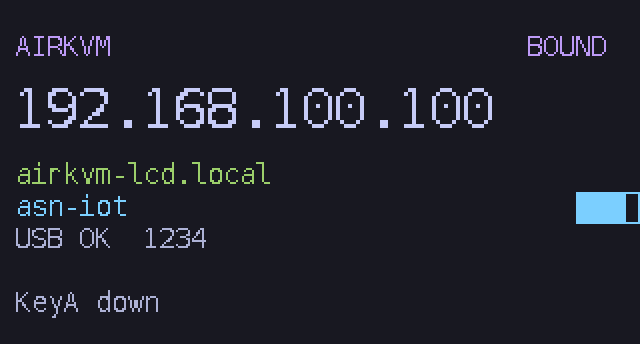
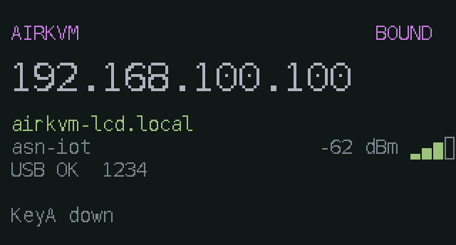
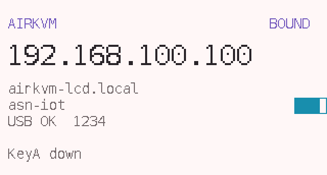
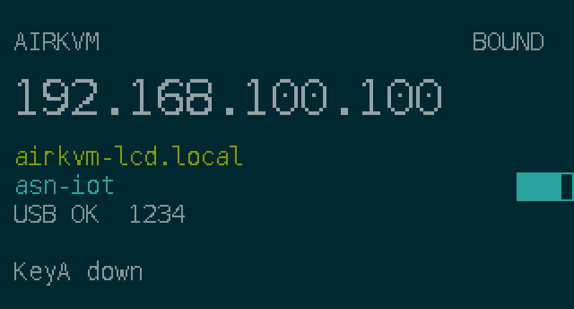
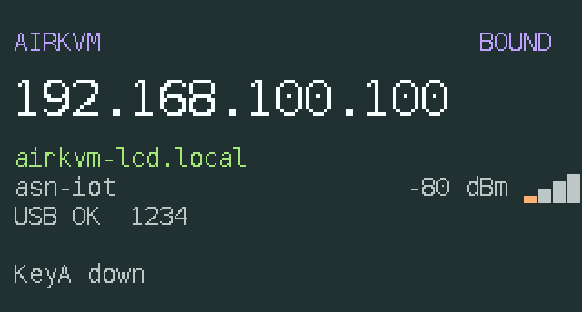
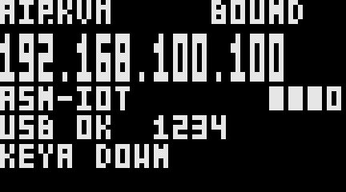

# airkvm

> 🤖 **AI Agents:** read [`AGENTS.md`](AGENTS.md) instead. This README is for humans.

A ~$12 ESP32-S3 board that plugs into any machine's USB port, enumerates as a **real USB keyboard
and mouse** (and a removable disk you can drop an ISO onto from the browser — the disk
enumerates, though nothing has booted from one yet), and serves a web console you drive from your laptop's browser. Hold BOOT for five seconds and
it becomes a WiFi access point with a setup page, so a dongle can move between networks without a
cable. Walk up to a machine,
plug it in, open a URL, type. Nothing installed on the target. Nothing installed on your laptop.

Because the target sees a plain HID keyboard, it works where software remote-control doesn't:
BIOS/UEFI setup, boot menus, disk-unlock prompts, a hung desktop, a machine with no OS yet.

**Status:** early, but no longer hypothetical. It has run on real hardware since 2026-09-04:
enumeration and typing verified against a live target (17 of 17 characters, machine-checked), both
status panels, WiFi, the HTTPS console, and OTA updates. Two boards run it today.

Still unproven, and called out wherever it is claimed: **BIOS/UEFI boot-protocol typing**, which is
the claim this project exists for and which no OS-booted host can test; the mouse path; and a target
actually booting from the removable disk. See
[open issues](https://github.com/abradner/airkvm/issues) for what's done, and `docs/repo-map.md`
(R-005) for what is still marked unverified.

## The shape of it

```
your laptop's browser                    airkvm dongle              the target machine
┌──────────────────────────┐  WiFi/WS   ┌─────────────────┐   USB   ┌──────────────┐
│ keyboard + pointer lock ─┼──────────► │ WebSocket → HID │ ──────► │ sees a plain │
│                          │            │ reports         │         │ kbd + mouse  │
│ video ◄──── (local USB) ─┼─ ─ ─ ─ ─ ─ ┼ (not involved)  │         │              │
│   from your HDMI capture │            │                 │         └──────────────┘
└──────────────────────────┘            └─────────────────┘
```

Video is deliberately **not** the dongle's job. If you have an HDMI→USB capture stick, it's just a
webcam to your laptop — the console shows it in the same tab via `getUserMedia`, so the video path
stays local and full-framerate instead of being squeezed through a microcontroller.

## Hardware

| Part | Notes |
|---|---|
| ESP32-S3-0.42 OLED "supermini" | ~$12. The 0.42" OLED shows the dongle's IP, so you read it off the board instead of hunting for it. |
| That's it | The board's own USB-C is the HID port and the power source. |

**The S3 part is not optional.** HID output needs a native USB OTG controller, which means
ESP32-S3, S2, or P4. Classic ESP32, C3, C6 and H2 have a fixed-function USB-serial peripheral that
physically cannot present as a keyboard. If you have non-OTG boards you want to use, the planned
path is a CH9329 UART-to-HID module — not built yet.

## Getting started

```sh
mise install        # toolchain
mise run setup      # ESP-IDF v5.5 + esp32s3 compilers (one-time, several GB)
mise run config     # set WiFi SSID/password under "airkvm" — required, no default
./tools/make_certs.sh   # TLS cert + a local CA (see "HTTPS" below)
mise run build
PORT=/dev/tty.usbmodem1101 mise run flash
```

The dongle shows its address on the OLED (and logs it on boot) — `http://<ip>/`, also
`http://airkvm.local/`. Open that on your laptop, click the video pane to capture, and type.

On a phone the same address is a trackpad and a keyboard, with no video: one finger moves the
pointer, a tap clicks, holding a finger still then moving drags, two fingers scroll, and a
two-finger tap right-clicks. The **Keyboard** button opens the phone's own keyboard, and
modifiers on the key rows latch — tap Ctrl, then C. Typed characters are sent as US-layout key
positions, so a target set to another layout gets different punctuation. Backgrounding the phone
ends the session and releases every key on the target, on purpose; coming back reconnects.

## The front panel

The little screen shows what you need when you walk up to the thing: its IP, the network it's on
with a signal bar, whether a browser currently holds the keyboard, and whether a target is
actually listening on USB. The LED is dark when nobody is connected, breathes gently while a
console is bound, and blips on each keystroke — so you can tell "my input isn't arriving" from
"the target is ignoring me" without opening a log.

Pressing the **BOOT** button toggles a debug row that shows live input as it arrives. That is
genuinely useful for "is it me or the machine?", and it is also a screen showing your keystrokes,
so it is off by default and can *only* be turned on by physically pressing the button — there is
no network path to it. While it is off, keystroke text is never stored at all.

On the 1.47" LCD the four ink roles are coloured by a theme, and each section of the screen gets
its own hue — so the address, the network row and the signal gauge are told apart by colour as well
as position. The gauge's colour is the one that carries meaning: it goes amber on a weak link, on
the same threshold the LED uses, so the two can never disagree.

| Monokai Pro — Filter Machine *(default)* | Tokyo Night |
|---|---|
|  |  |
| **One Dark Pro Night Flat** | **Monokai Pro — light** |
|  |  |
| **Solarized Dark** | **Weak link — the gauge goes amber** |
|  |  |

And the 0.42" dongle's panel, which is 1bpp and 72×40:



These are **renders, not photographs**: `tools/preview_ui.py` draws the real font tables at the real
layout offsets in the real theme colours, quantised to RGB565 so they show what the panel can
actually produce. They prove the layout fits and the colours are what the table says — not how the
panel looks in a room. `docs/img/themes/` has the full set and the argument.

That dongle gets no theme, and the console does not offer it one: on a 1bpp panel every ink role is
the same lit pixel, so a theme control there would be a control that provably does nothing.

To reflash after the first flash, hold **BOOT** and tap **RESET** first: once the firmware claims
USB for HID, the board stops being a serial device until you put it back in bootloader mode.

No browser handy? `tools/poke.py` speaks the same protocol from a terminal:

```sh
./tools/poke.py airkvm.local type "hello world"
./tools/poke.py airkvm.local key ControlLeft+AltLeft+Delete
```

`mise run test` runs the host-side unit tests for the keymap, protocol codec, and HID state
machine — no board required, and the only check here that proves behavior rather than compilation.

## HTTPS

The console is served over HTTPS, for two reasons. Without it your keystrokes cross the network in
plaintext for anyone on the LAN to read, and browsers refuse camera access to non-secure origins —
so over plain HTTP the capture-device dropdown is simply empty.

`./tools/make_certs.sh` issues the device certificate, creating a local CA the first time (pass
`--ca-cert`/`--ca-key` to use one you already run). Install that CA once per machine you browse
from; the script prints the command. Deliberately *not* a self-signed device certificate: Chrome
now resists those by default and restricts some powerful APIs even after a click-through, so a
self-signed cert risks paying the whole cost of TLS and still leaving the camera unavailable.

Browse to `https://airkvm.local/` — the certificate is issued for that name, so the bare IP will
warn every time.

## Security, stated plainly

**Anyone who can reach the dongle on the network can type on the target.** Traffic is encrypted,
but there is no authentication — TLS protects your keystrokes from onlookers, not the target from
whoever connects. That is the current design, not an oversight in progress: the security model is
physical — plugging it in is a deliberate act, unplugging it is complete revocation. Use it on
networks you trust, and unplug it when you're done. The trust boundaries and what would fix this
are written up in [`docs/repo-map.md`](docs/repo-map.md).

## Prior art

This project exists because of, and borrows design from, work that got there first:

- [KMChris/esp32-kvm-ip](https://github.com/KMChris/esp32-kvm-ip) — the direct inspiration:
  ESP32-S3 HID output driven over the network. Its host-side capture app is Windows-only (Win32
  low-level hooks over UDP), which is what prompted the browser-based console here.
- [espkvm/espkvm](https://github.com/espkvm/espkvm) — a full IP-KVM on the ESP32-P4 with HDMI
  capture on-device. The absolute-pointer approach is worth stealing.

## License

Apache-2.0. See [LICENSE](LICENSE).
